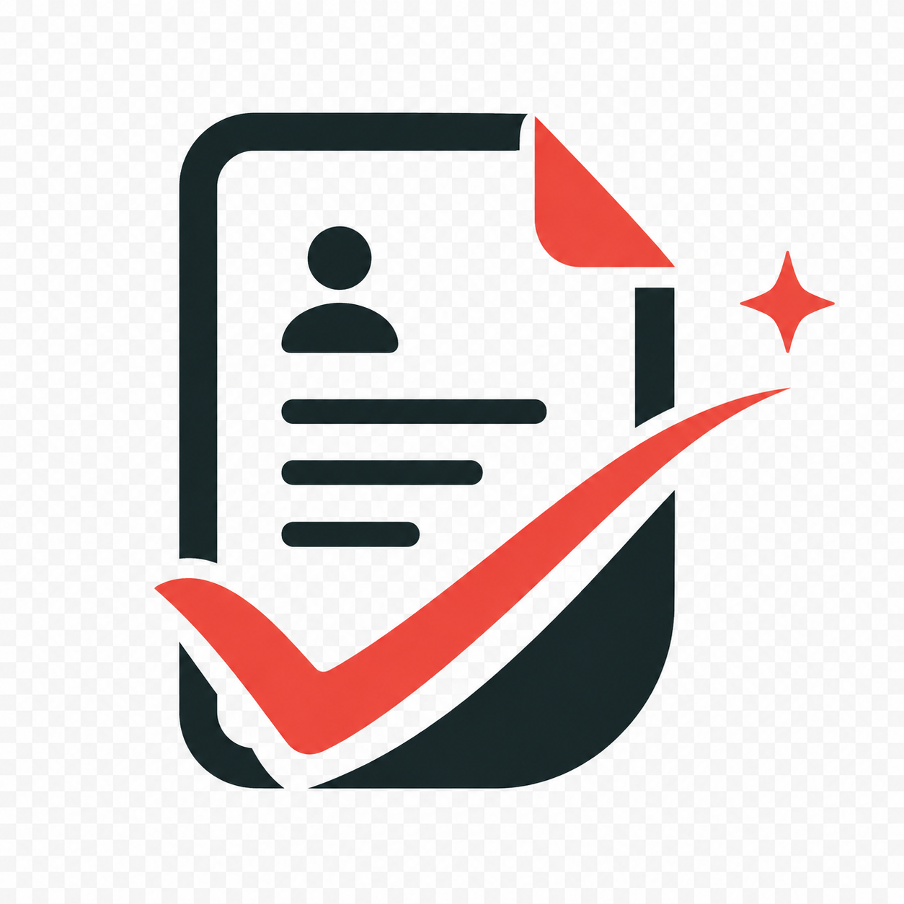
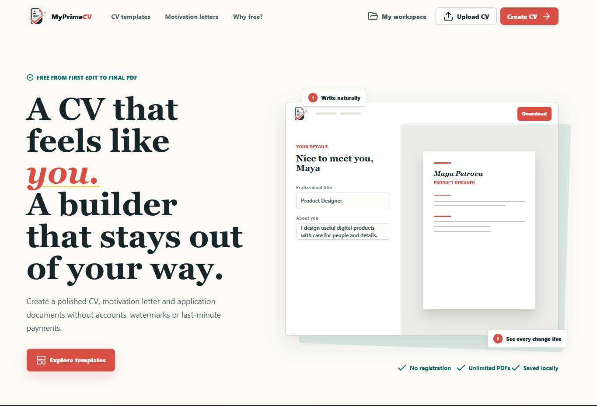

<h1> MyPrimeCV</h1>

### Create job application documents that feel like yours!

MyPrimeCV is a browser-based CV and motivation letter builder that's **ABSOLUTELY FREE** from your first edit to your final PDF. Create your documents, see the layout as you edit, and export a polished CV PDF with no fees along the way.

  

## What you can create

- **CVs:** Add your contact details and profile, then organize your experience, education, skills, languages, projects, links, and custom sections.
- **Motivation letters:** Write a tailored letter with sender and recipient details, a subject, greeting, body paragraphs, and a closing.

## Completed CV templates

Choose from six templates with working editors:

- **Meadow** — supports a profile photo.
- **Atlas**
- **North**
- **Linen**
- **Studio** — supports a profile photo.
- **Ribbon**

## How it works

1. **Choose** a CV template or start a motivation letter.
2. **Add and arrange** your details in the editor.
3. **Preview** the document in its page layout as you work.
4. **Download** your CV as a PDF.

## Your workspace

- CVs and letters are saved locally in your browser; no account is required.
- Browse your documents, mark favorites, and manage deleted items in the trash.
- Export a JSON backup to keep a copy of your workspace, or restore one later.

## 
<strong>Create, edit, and download your documents absolutely free from beggining to the end!</strong>

> **Tip:** Clearing browser data can remove locally saved documents. Export a backup to keep a copy.
