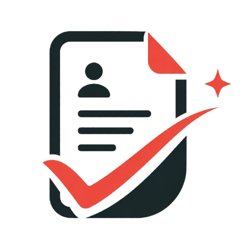

<h1> MyPrimeCV</h1>

MyPrimeCV is a free, browser-based tool for creating and organizing job application documents. Build a CV and a tailored motivation letter, preview your work as you edit, and export a polished PDF.

## CV builder

Add your contact details and professional profile, then fill in experience, education, skills, languages, projects, links, and custom sections. Choose from six editable designs: Meadow, Atlas, North, Linen, Studio, and Ribbon. The page preview shows how your CV is laid out, and you can export it as a PDF.

## Motivation letters

Create a letter with sender and recipient details, a subject and greeting, editable body paragraphs, and a professional closing. The preview updates as you work so you can review the finished letter.

## Your workspace

CVs and letters are saved in your browser, where you can browse your documents, mark favorites, and manage items in the trash. Export a JSON backup to keep a copy of your workspace, or restore one later.

Documents are stored locally in the browser rather than in a MyPrimeCV account. Clearing browser data can remove locally saved documents, so keep a backup if you need one.
